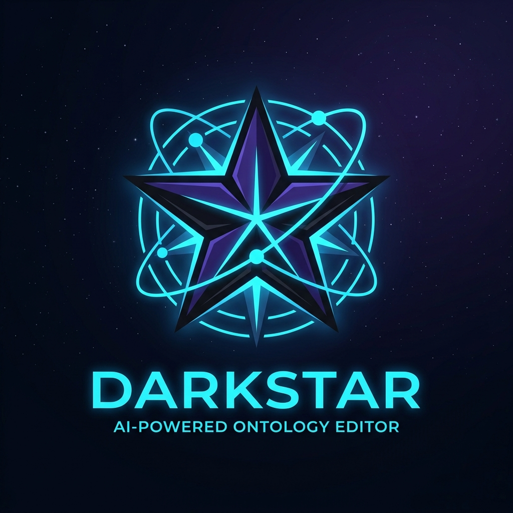

# Darkstar: Professional OWL 2 RL Ontology Editor

<p align="center">
  
</p>

Darkstar is a high-performance, professional-grade ontology editor and inference engine built with Rust. It provides a visual and intuitive way to manage complex OWL 2 RL ontologies with real-time reasoning, explanation facilities, advanced querying (SPARQL & DL Query), dynamic plugin extensions, and state-of-the-art graph visualization.

[English](#english) | [한국어](#한국어)

---

<a name="english"></a>
## English

### Key Features

#### 🧠 Reasoning Engine & Explanation
- **Full OWL 2 RL Compliance**: High-performance parallel forward-chaining rule engine powered by [Rayon](https://github.com/rayon-rs/rayon).
- **Inference Explanation (Justification)**: Dedicated explanation view to trace and prove inferred triples, inspecting which rules and antecedent triples produced them.
- **Consistency & Safety**: Built-in ontology consistency checking, violation detection, and safety confirmation guards.

#### 🔍 SPARQL 1.1 & DL Query Engine
- **Full SPARQL 1.1 Support**: Powered by Oxigraph's SPARQL query evaluation components (`spargebra` and `spareval`), supporting SELECT queries with BGP, FILTER, OPTIONAL, ORDER BY, and aggregation.
- **Manchester Syntax DL Query**: Execute Description Logic class expressions (e.g., `hasChild some Person`, SubClasses, SuperClasses, EquivalentClasses, Instances) with instant tabular results.

#### 🎨 Advanced Force-Directed Graph Visualization
- **Multiple Layout Algorithms**: Force-Directed, Hierarchical, Radial, Circular, Concentric, and Grid.
- **Physics Simulation & Collision Resolution**: Tuned force physics and active collision-avoidance algorithms preventing overlapping nodes.
- **Bidirectional & Curved Edge Rendering**: Clean, legible curved paths for two-way relationships.
- **Layered Z-Index & Transparent Aesthetics**: Label-first rendering ensuring edges never occlude text, with crisp background-free typography.
- **Complexity Guard & Quick-Fixes**: Proactive warning dialogs for dense graphs with one-click filtering options to preserve 60 FPS rendering.
- **High-Resolution Screenshot Export**: One-click capture of the visual graph.

#### 🧩 Comprehensive OWL 2 RL Modeling
- **Class Hierarchy & Description View**: Tree-based navigation of classes with a Manchester Syntax class expression editor.
- **Property Hierarchy**: Dedicated tab for Object Properties, Datatype Properties, and Annotation Properties, including domain, range, and property characteristics (Functional, Transitive, Symmetric, etc.).
- **Individual Management**: Filtering, search, and asserted vs. inferred triple inspection with reverse incoming relations view.
- **Direct Source Editor**: Integrated Turtle/RDF editor with real-time parsing validation and bidirectional synchronization with the active graph.

#### 🔌 Dynamic Plugin Architecture
- **Runtime Plugin Loading**: Dynamically loads external native plugins (`.dylib` on macOS, `.so` on Linux, `.dll` on Windows) via `libloading`.
- **Extensible Tabs & Hooks**: Add custom analysis, visualization, or ontology transformation modules without recompiling the main binary. See [External Plugin Guide](docs/EXTERNAL_PLUGINS.md).

#### 📂 Ontology Modularity & Multi-Format I/O
- **`owl:imports` Resolution**: Load, manage, and recursively resolve external ontologies from local files or remote URIs.
- **Multi-Format Serialization**: Seamless import and export across Turtle (.ttl), RDF/XML (.rdf, .owl), and N-Triples (.nt).
- **Undo / Redo & Event History**: Comprehensive change tracking and timeline of actions with full roll-back capabilities.

#### 🖥️ Modern Docking UI & Productivity
- **Multi-Tab Docking Layout**: Free-form window docking powered by `egui_dock` (Classes, Properties, Individuals, Graph, Query, Explain, History, Source Editor).
- **Rich Status Bar & Memory Monitor**: Live display of active triple counts, inferred counts, reasoning status, and real-time process memory footprint.
- **Modern User Experience**: Splash screen, card-style onboarding wizard, dark/light theme persistence, UI scaling, and bilingual localization (English / 한국어).

---

### Tech Stack

- **Core & Runtime**: [Rust](https://www.rust-lang.org/) (2021 edition)
- **UI & Docking**: [egui](https://github.com/emilk/egui) / [eframe](https://github.com/emilk/egui/tree/master/crates/eframe) / [egui_dock](https://github.com/Adanos020/egui_dock) / [egui_extras](https://github.com/emilk/egui/tree/master/crates/egui_extras)
- **RDF & SPARQL Engine**: [Sophia](https://github.com/pchampin/sophia_rs) / [spargebra](https://crates.io/crates/spargebra) / [spareval](https://crates.io/crates/spareval) / [oxrdf](https://crates.io/crates/oxrdf)
- **Parallel Computing**: [Rayon](https://github.com/rayon-rs/rayon) / [Tokio](https://tokio.rs/)
- **Dynamic Plugin System**: [libloading](https://crates.io/crates/libloading)

---

<a name="한국어"></a>
## 한국어

### 주요 기능

#### 🧠 고성능 추론 엔진 및 추론 설명 (Inference Explanation)
- **완벽한 OWL 2 RL 지원**: [Rayon](https://github.com/rayon-rs/rayon) 기반 고성능 병렬 전방 추론(Forward-Chaining) 규칙 엔진 탑재.
- **추론 근거 설명기 (Explanation View)**: 추론된 모든 트리플(Inferred Triples)에 대해 어떤 규칙과 전제 트리플들로부터 도출되었는지 증명 경로(Justification)를 시각적으로 추적.
- **일관성 및 안전 검증**: 온톨로지 일관성(Consistency) 검증, 위반 사항 탐지 및 안전 확인 모달 지원.

#### 🔍 SPARQL 1.1 및 Manchester Syntax DL Query 엔진
- **SPARQL 1.1 쿼리 지원**: Oxigraph의 `spargebra` 및 `spareval` 엔진을 결합하여 BGP 매칭, FILTER, OPTIONAL, 정렬, 집계 등을 포함하는 SELECT 쿼리 완벽 지원.
- **Manchester Syntax DL Query**: 서술 논리(Description Logic) 클래스 표현식(예: `hasChild some Person`, 하위 클래스, 상위 클래스, 동치 클래스, 인스턴스 검색)을 직접 쿼리하고 직관적인 표 형태로 확인.

#### 🎨 고도화된 힘 지향(Force-Directed) 그래프 시각화
- **다양한 레이아웃**: Force-Directed, Hierarchical, Radial, Circular, Concentric, Grid 레이아웃 제공.
- **물리 시뮬레이션 및 충돌 방지**: 최적화된 물리 파라미터 및 노드 간 겹침을 방지하는 실시간 충돌 해결(Collision Resolution) 알고리즘 적용.
- **양방향 곡선 엣지 렌더링**: 양방향 관계를 시각적으로 분리하여 가독성이 뛰어난 곡선으로 표현.
- **레이어 기반 Z-Index & 투명도 최적화**: 엣지가 텍스트 라벨을 가리지 않도록 렌더링 순서를 제어하며 깔끔한 무배경 라벨 디자인 적용.
- **복잡도 경고 및 퀵픽스(Quick-Fix)**: 대규모 온톨로지 렌더링 시 사전 경고 및 60 FPS 유지를 위한 원클릭 필터 제공.
- **고해상도 스크린샷 내보내기**: 현재 그래프 뷰를 고품질 이미지로 즉시 캡처하여 저장.

#### 🧩 전문적인 OWL 2 RL 온톨로지 모델링
- **클래스 계층 & 디스크립션 뷰**: 트리 형태의 클래스 계층 탐색과 Manchester Syntax 기반 복합 클래스 논리 표현식(SubClassOf, EquivalentClasses, Restrictions 등) 편집.
- **속성(Properties) 계층 관리자**: Object Property, Datatype Property, Annotation Property의 계층 구조 및 도메인(Domain), 범위(Range), 특성(Functional, Transitive, Symmetric 등) 상세 관리.
- **개체(Individuals) 관리**: 타입 필터링, 검색, 명시적/추론적 트리플 구분 확인 및 역방향 참조(Incoming Relations) 추적.
- **직접 소스 편집기 (Source Editor)**: 실시간 구문 검증 및 그래프/모델과 양방향으로 동기화되는 내장 Turtle/RDF 편집기.

#### 🔌 동적 플러그인 아키텍처 (Dynamic Plugin System)
- **런타임 플러그인 로딩**: `libloading`을 통해 컴파일 없이 동적 라이브러리(`.dylib`, `.so`, `.dll`) 플러그인을 자동으로 로드.
- **확장 탭 및 이벤트 훅**: 온톨로지 변경 이벤트를 구독하고 독자적인 분석 및 UI 탭을 손쉽게 추가 가능. 상세 내용은 [외부 플러그인 개발 가이드](docs/EXTERNAL_PLUGINS.md) 참고.

#### 📂 온톨로지 모듈화 & 멀티 포맷 I/O
- **`owl:imports` 지원**: 로컬 파일 또는 원격 URL의 외부 온톨로지 임포트 구문을 해석하고 통합 추론 수행.
- **다양한 RDF 포맷 입출력**: Turtle (.ttl), RDF/XML (.rdf, .owl), N-Triples (.nt) 완벽 지원.
- **실행 취소 / 다시 실행 및 히스토리 탭**: 모든 편집 작업을 타임라인 형태로 기록하고 언제든 이전 상태로 복구(Undo/Redo).

#### 🖥️ 현대적인 도킹 UI 및 생산성
- **자유로운 멀티탭 도킹**: `egui_dock` 기반으로 클래스, 프로퍼티, 개체, 그래프, 쿼리, 추론 설명, 히스토리, 소스 편집기 창을 원하는 레이아웃으로 배치.
- **상태 표시줄 및 실시간 메모리 모니터링**: 활성 트리플 수, 추론된 트리플 수, 엔진 상태, 실제 프로세스 메모리 사용량 실시간 표시.
- **프리미엄 사용자 경험**: 스플래시 화면, 카드 스타일 온보딩 위저드, 테마(다크/라이트) 및 UI 배율 영속성, 완벽한 한/영 다국어 지원.

---

### 기술 스택

- **핵심 언어 및 런타임**: [Rust](https://www.rust-lang.org/) (2021 edition)
- **UI & 도킹 프레임워크**: [egui](https://github.com/emilk/egui) / [eframe](https://github.com/emilk/egui/tree/master/crates/eframe) / [egui_dock](https://github.com/Adanos020/egui_dock) / [egui_extras](https://github.com/emilk/egui/tree/master/crates/egui_extras)
- **RDF & SPARQL 엔진**: [Sophia](https://github.com/pchampin/sophia_rs) / [spargebra](https://crates.io/crates/spargebra) / [spareval](https://crates.io/crates/spareval) / [oxrdf](https://crates.io/crates/oxrdf)
- **병렬 컴퓨팅 & 비동기**: [Rayon](https://github.com/rayon-rs/rayon) / [Tokio](https://tokio.rs/)
- **동적 플러그인 시스템**: [libloading](https://crates.io/crates/libloading)

---

## Getting Started / 시작하기

### Prerequisites / 사전 요구사항

- [Rust](https://www.rust-lang.org/tools/install) (latest stable version, 1.75+)

### Build and Run / 빌드 및 실행

```bash
# 저장소 클론
git clone https://github.com/tsarkr/darkstar.git
cd darkstar

# 실행 (최초 실행 시 온보딩 위저드가 나타납니다)
cargo run --release
```

### Packaging / 패키징

운영체제(macOS/Windows)에 맞는 설치 파일(.dmg, .app, .msi 등)을 생성하려면 아래 스크립트를 실행하세요:

```bash
./package.sh
```

---

## Documentation / 관련 문서

- [External Plugin Development Guide (외부 플러그인 개발 가이드)](docs/EXTERNAL_PLUGINS.md)

---

## License / 라이선스

TBD (To Be Determined) / 미정

## Authors / 작성자

- **Gyungmin** ([@tsarkr](https://github.com/tsarkr))

